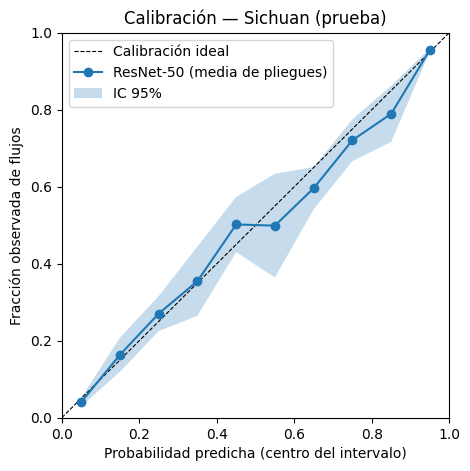
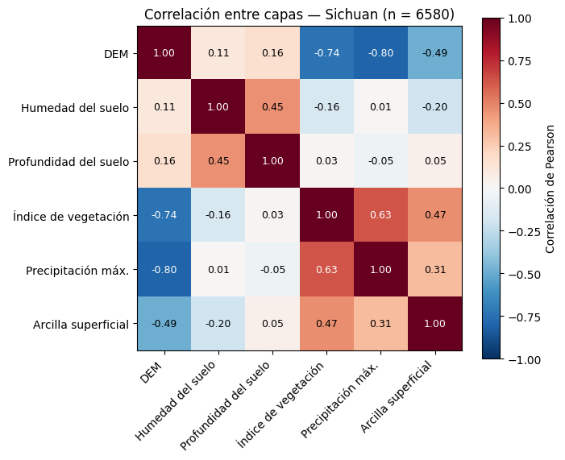
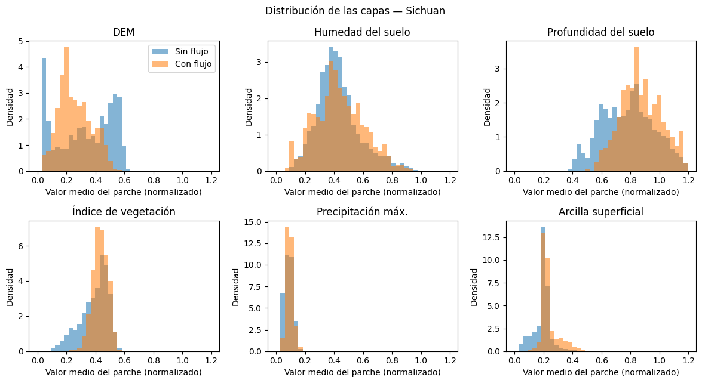

# Réplica: susceptibilidad a flujos de detritos con deep learning (Sichuan)

Réplica de la etapa de modelado del paper:

> Nienkötter, A., Bian, A., Di, B., Li, J. y Deng, T. (2026). *Assessing Debris-Flow Susceptibility at Local and Global Scales: A Deep-Learning-Based Comparative Study of Sichuan, China, and Worldwide*. Remote Sensing, 18(9), 1442. https://doi.org/10.3390/rs18091442

Se entrena ResNet-50 sobre el conjunto local de Sichuan con los datos y el código que publican los autores. El objetivo es validar que el pipeline de deep learning reproduce un resultado publicado, como paso previo a aplicarlo a huaicos en Perú.

## Resultados

Conjunto de prueba de Sichuan (10% de los datos), 10 pliegues con validación cruzada espacial. Intervalos de confianza al 95% sobre los pliegues.

| Modelo | AUC réplica | AUC paper |
| --- | --- | --- |
| ResNet-50 | 0.946 ± 0.005 | 0.957 ± 0.002 |
| Histogram Gradient Boosting | 0.854 ± 0.003 | 0.894 ± 0.004 |
| Random Forest | 0.852 ± 0.005 | 0.874 ± 0.008 |

AUC de ResNet-50 por pliegue: 0.9413, 0.9325, 0.9441, 0.9618, 0.9486, 0.9458, 0.9468, 0.9441, 0.9506 y 0.9403 (media 0.9456, mediana 0.9449, desviación estándar 0.008).

**Lectura.** La media queda 0.011 por debajo del paper, pero el 0.957 cae dentro del rango de los pliegues (0.933–0.962). La diferencia no viene de reportar mediana en vez de media; lo más probable es que venga de particiones distintas, ya que el código original no fija semilla. El modelo profundo supera a las líneas base de ML por unos 0.09 de AUC, igual que en el paper (0.06–0.08).

### Calibración (figura 8 y tabla 4 del paper)

Scores agrupados en 10 intervalos iguales y una recta ajustada entre el centro de cada intervalo y la fracción observada de flujos.

| ResNet-50 | Réplica | Paper |
| --- | --- | --- |
| Pendiente (ideal 1) | 0.945 ± 0.044 | 0.790 ± 0.09 |
| Intercepto (ideal 0) | 0.017 ± 0.032 | −0.134 ± 0.167 |

La réplica sale mejor calibrada que el paper y los intervalos de la pendiente no se cruzan; el paper muestra una tendencia a sobreestimar que aquí no aparece. Con una regresión del score contra la etiqueta, muestra por muestra, da 0.965 ± 0.018 y 0.008 ± 0.015.

### Tasas por tipo de muestra (tabla 7 del paper, columna base)

Umbral por pliegue que maximiza el índice de Youden en el conjunto de prueba (331 flujos reales, 188 negativos `near` y 147 `far`).

| Muestra | Réplica | Paper |
| --- | --- | --- |
| Flujos reales detectados (TPR) | 0.876 ± 0.023 | 0.858 |
| Falsos positivos en `near` (FPR) | 0.148 ± 0.031 | 0.122 |
| Falsos positivos en `far` (FPR) | 0.047 ± 0.008 | 0.048 |

Los tres valores del paper caen dentro de los intervalos de la réplica. Se repite el patrón: los negativos cercanos a un flujo son unas 3 veces más difíciles que los lejanos.

### Correlación entre capas (figura 11 del paper)

Media de cada capa por parche, sobre las 6,580 muestras de Sichuan. Las 15 correlaciones coinciden con la figura 11 del paper al centésimo; por ejemplo, el DEM tiene −0.80 con la precipitación máxima, −0.74 con el índice de vegetación y −0.49 con la arcilla superficial. Esto confirma que se usan los mismos datos y el mismo método que los autores.

### Distribución de las capas (figura 12 del paper)

Como en el paper, en Sichuan las distribuciones con y sin flujo se solapan mucho. El DEM es la capa que más separa: los flujos aparecen en cotas más bajas (media normalizada 0.26 frente a 0.33). La arcilla superficial se concentra cerca de 0.2 en ambas clases.

## Alcance

| Parte del paper | Estado |
| --- | --- |
| Inventario, negativos en dos pasos, parches de 6 capas y partición 90/10 | Tomados de Zenodo (datos de los autores) |
| ResNet-50, 10 pliegues (tabla 3, figura 7) | Replicado |
| Random Forest y Histogram Gradient Boosting | Replicado con entradas aproximadas |
| Calibración (tabla 4, figura 8) | Replicado |
| Tasas por tipo de muestra (tabla 7, columna base) | Replicado |
| Correlación entre capas (figura 11) | Replicado (coincide al centésimo) |
| Distribución de las capas (figura 12) | Replicado |
| Importancia de capas por leave-one-out (figuras 13–15, tabla 6 y resto de la tabla 7) | Pendiente: requiere reentrenar sin cada capa |
| VGG-16 y Vision Transformer | No replicado |
| Modelo global (13,465 parches) | No replicado |
| Efecto de los radios de muestreo (tabla 5) | No replicable sin los datos crudos |
| Mapas de susceptibilidad (figuras 9, 10, 14 y 15) | No replicable sin los datos crudos |

Los mapas requieren las 6 capas crudas de toda la zona (ASTER GDEM, AMSR2, VIP EVI2, GPM IMERG y HWSD). Zenodo solo publica los parches ya recortados en los puntos del inventario, sin coordenadas.

## Cómo correrlo

Todo corre en Google Colab con GPU T4 gratis y Google Drive.

1. Deja al menos 6 GB libres en Google Drive.
2. Abre `replica_nienkotter_sichuan.ipynb` en Colab y elige Entorno de ejecución → Cambiar tipo de entorno → GPU T4.
3. Corre las celdas en orden:

| Celda | Qué hace | Tiempo aproximado |
| --- | --- | --- |
| 1 | Revisa la GPU y monta Drive | 1 min |
| 2 | Descarga los 4 archivos de Sichuan de Zenodo (2.6 GB) y verifica el md5 | 15 min, solo la primera vez |
| 3 | Clona el repositorio de los autores y aplica las correcciones | 3 min |
| 4 | Copia los datos al disco de Colab | 2 min |
| 5 | Prueba corta: 1 pliegue, 2 épocas | 4 min |
| 6 | Entrena ResNet-50 con 10 pliegues | ~5 h |
| 7 | (Opcional) Entrena VGG-16 | No medido |
| 8 | Líneas base RF y HGB, sin GPU | 10 min |
| 9 | Tabla de resultados, calibración y curvas ROC | 5 min |
| 10 | AUC por pliegue y mediana | 1 min |
| 11 | Predicciones de cada pliegue en prueba | 3 min |
| 12 | Calibración con intervalos (figura 8, tabla 4) | 1 min |
| 13 | Tasas por tipo de muestra (tabla 7) | 1 min |
| 14 | Correlación entre capas (figura 11) | 5 min |
| 15 | Distribución de las capas (figura 12) | 1 min |

Las celdas 10 a 13 necesitan la celda 9 corrida en la misma sesión; en una sesión nueva, corre 1, 3, 4 y 9 antes. Las figuras se guardan en `results/figuras/` dentro de la carpeta de Drive.

Una época de ResNet-50 tarda unos 1.6 minutos en una T4, y cada pliegue unos 30. Si Colab corta la sesión, vuelve a correr las celdas 1 a 4 y luego la 6: retoma desde el último pliegue terminado. No cambies `N_FOLDS` a mitad de un entrenamiento, porque cambia la partición.

## Cambios al código original

El notebook clona el repositorio de los autores y aplica estos cambios al vuelo; el código original no está incluido en este repositorio.

- Crea `locations_train.json` y `locations_test.json`, que el cargador de HDF5 necesita y Zenodo no trae.
- Renombra los archivos de Zenodo (`sichuan_locations_*`) a los nombres que espera el código (`locations_*`).
- `train.py` → `train_patched.py`:
  - Semilla fija (`random_state=42`) en `StratifiedGroupKFold`, para que los pliegues no cambien entre sesiones.
  - Número de pliegues configurable con la variable de entorno `N_FOLDS`.
  - Reanudación: marca cada pliegue terminado y lo salta al volver a correr.
  - No guarda el estado del optimizador, para ahorrar espacio en Drive.
- `dataloader.py`: carga el HDF5 entero en memoria para acelerar cada época.

Las opciones reales de `train.py` son `--model`, `--training-set`, `--save-folder`, `--max-epochs` y `--hdf5-data`; el README del repositorio original usa otros nombres.

## Configuración

| Aspecto | Valor |
| --- | --- |
| Entrada | Parche de 6 × 128 × 128 (unos 3.8 km de lado), normalizado a [0, 1] |
| Capas | DEM, humedad del suelo, profundidad del suelo, índice de vegetación, precipitación máxima y arcilla superficial |
| Partición | 90% entrenamiento y 10% prueba por cuadrícula; 10 pliegues agrupados por `spatial_group_id` |
| Aumento | Rotaciones de 90° (×4) |
| Entrenamiento | BCE con logits; Adam, lr 1e-4, StepLR (×0.9 por época); batch 16 |
| Parada | Tras 5 épocas sin mejora en validación (mínimo 9), máximo 40 |
| Líneas base | RF (500 árboles) y HGB sobre media, desviación, mínimo y máximo de cada capa (24 variables) |

## Fuentes

- Datos: Nienkötter, A. (2026). *Remote Sensing image patches at debris flow locations, globally and in Sichuan, China* (v2) [Dataset]. Zenodo. https://doi.org/10.5281/zenodo.20034823. Licencia CC BY 4.0.
- Código original: https://gitlab.com/ankidmr/multi-scale-debris-flow-susceptibility. El repositorio no declara una licencia, por eso aquí no se redistribuye: el notebook lo clona.

Los datos de entrenamiento (`*.hdf5`, `*.csv`) y los modelos entrenados (`*.pth`) no se suben a este repositorio; se descargan o generan al correr el notebook.

## Autor

[Tu nombre] — Ingeniería de Software, Universidad de Lima. Trabajo de tesis sobre susceptibilidad a huaicos con deep learning.
